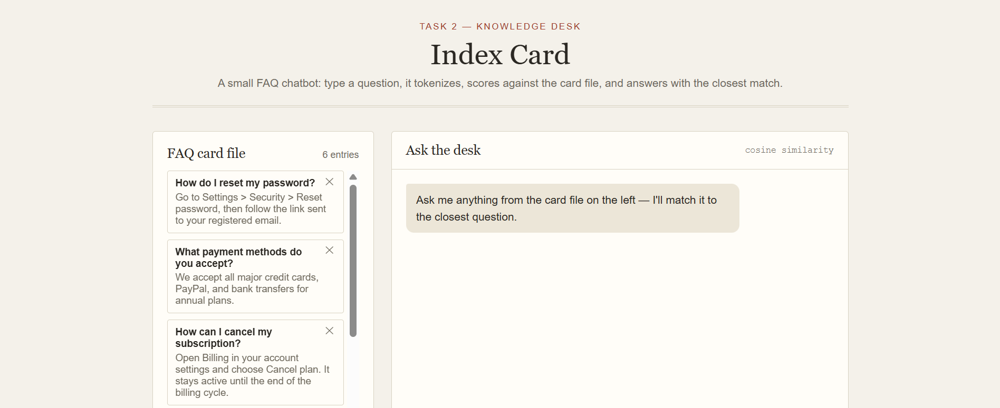
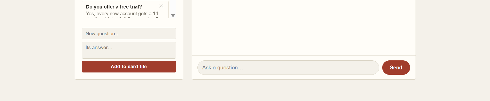

# Task 2 — Chatbot for FAQs ("Index Card")

A small FAQ chatbot that matches user questions to a knowledge base using TF-IDF and cosine similarity — entirely in the browser, no server or external NLP library required.

## Preview

## Files
- `index.html` — markup and structure
- `style.css` — visual styling
- `script.js` — preprocessing, vectorization, matching, and UI logic

## How it satisfies the brief
| Requirement | Where it's handled |
|---|---|
| Collect FAQs (questions + answers) | `faqs` array in `script.js`, seeded with 6 examples; editable live via the "Add to card file" form |
| Preprocess text (tokenize, clean) | `tokenize()` lowercases, strips punctuation, splits into tokens, and removes stopwords using the `STOPWORDS` list — a lightweight stand-in for NLTK/spaCy preprocessing |
| Match user questions to FAQs (cosine similarity / intent matching) | `findBestMatch()` builds TF-IDF vectors for every FAQ question and the user's query (`termFreq`, `inverseDocFreq`, `toVector`), then scores them with `cosineSim()` |
| Display the best matching answer | `handleSend()` posts the matched FAQ's answer into the chat log, along with the matched question and similarity score |
| Optional: simple chat UI | Chat bubble interface (`#chatLog`, `#chatInput`, `#sendBtn`) with user/bot message styling |

## How the matching works
1. Every FAQ question and the incoming user question are tokenized and stripped of stopwords.
2. A shared vocabulary is built across all of them.
3. Each is converted into a TF-IDF vector (term frequency × inverse document frequency).
4. The cosine similarity between the query vector and each FAQ vector is computed; the highest-scoring FAQ wins.
5. A confidence floor (`CONFIDENCE_THRESHOLD = 0.12` in `script.js`) prevents weak/unrelated matches from being shown as an answer — tune this constant to make matching stricter or looser.

## Extending it
- Swap the in-memory `faqs` array for a real backend (e.g. a `/faqs` API) if you want persistence across sessions.
- For more accurate matching at scale, swap the hand-rolled TF-IDF/cosine code for a proper NLP library (spaCy, scikit-learn's `TfidfVectorizer`, or a sentence-embedding model) — the seed/answer logic and UI wiring would stay the same.